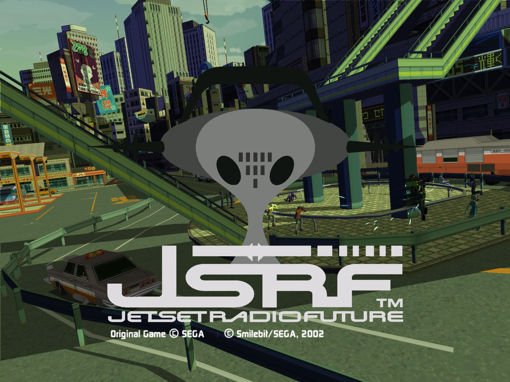
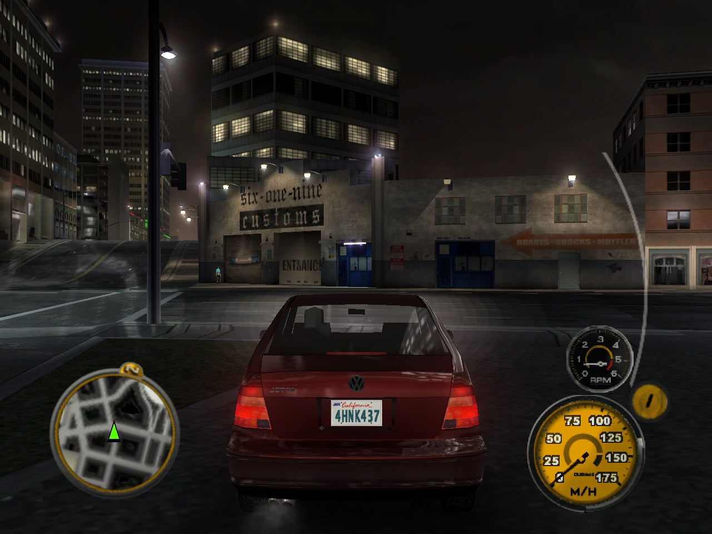
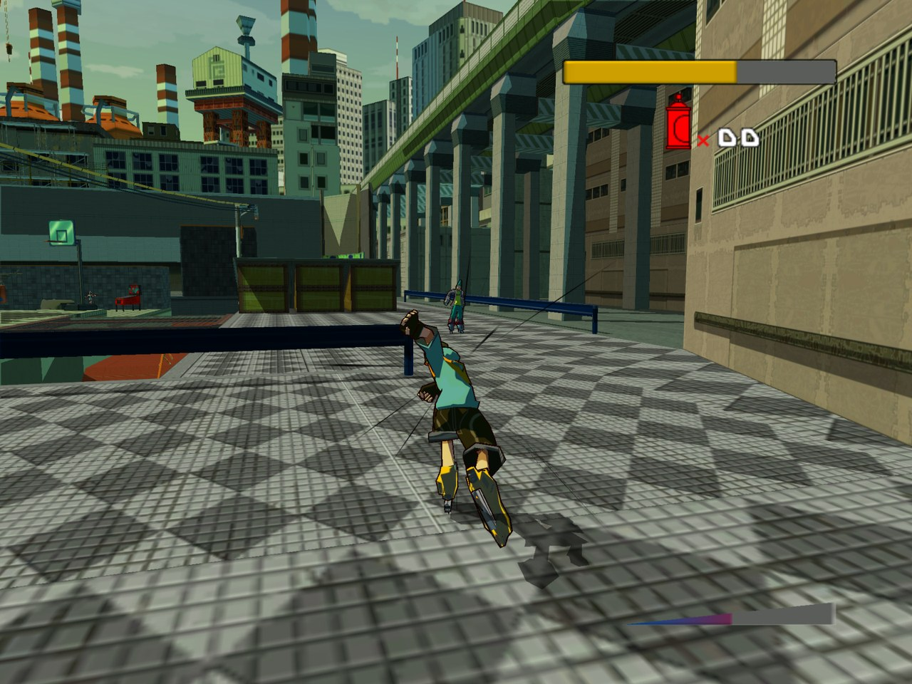
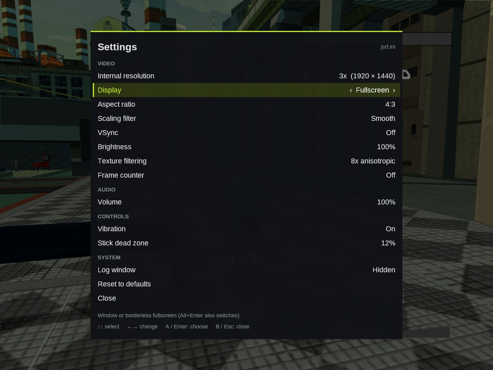
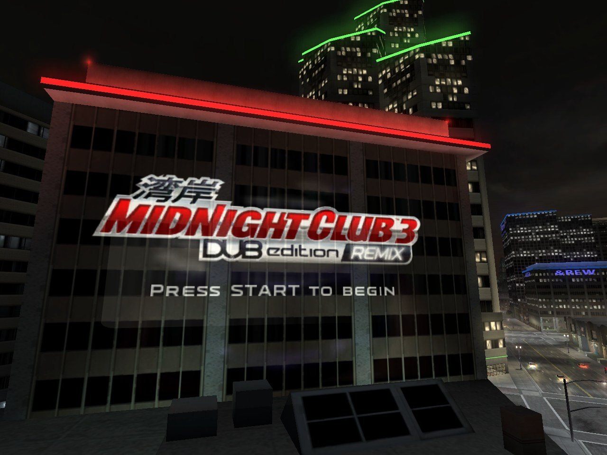
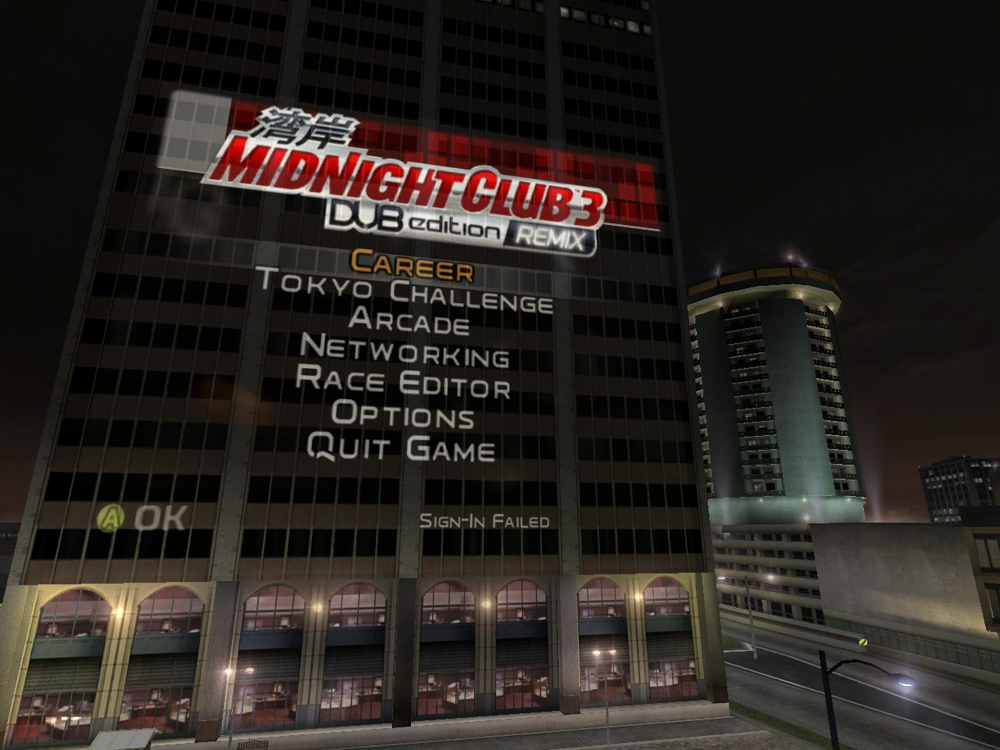

# Xbox PC Ports

Play your own copies of two original Xbox games natively on Windows, at up
to 8× their original resolution, with Xbox controllers and an in-game
settings menu:

| | Game | Port | Status |
|---|---|---|---|
|  | **Jet Set Radio Future** (2002) | **JSRF PC** (`jsrf.exe`) | 0.1.0: boot through the tutorial at 60 fps |
|  | **Midnight Club 3: DUB Edition Remix** (2006) | **MC3 PC** (`mc3.exe`) | 0.1.0: menus, Career start and free-roam driving at 30 fps |

<p align="center">
  
  
</p>

Each port loads the game's original Xbox executable and runs its code
directly on your PC's processor. The Xbox used an ordinary x86 CPU, so the
game's code doesn't need to be translated or interpreted. Everything the
game expects from the console around it (the Xbox kernel, the NV2A graphics
chip, the audio hardware, the controller ports) is re-created on top of
Windows and OpenGL. No Xbox BIOS or firmware is needed.

> [!IMPORTANT]
> **You need the games.** Nothing from either game is included here. Each
> port runs the files from the **North American** Xbox disc, dumped from a
> disc you own. Please don't ask for game files.

Both ports share one runtime (`core/`); everything specific to a game (its
version check, its symbol table and a few patches) lives in `titles/<game>/`.

## Contents

[Status](#status) ·
[Getting started](#getting-started) ·
[Controls](#controls) ·
[Settings](#settings) ·
[Options](#command-line-options) ·
[Troubleshooting](#troubleshooting) ·
[FAQ](#faq) ·
[How it works](#how-it-works) ·
[Building](#building-from-source) ·
[Credits](#credits) ·
[Legal](#legal)

## Status

### JSRF PC 0.1.0

Played for over 45 minutes on Windows 11 with an NVIDIA RTX 5090 and a
wireless Xbox controller, from boot through the intro, title screen, New
Game and the tutorial, at a steady 60 fps with sound in 4K borderless
fullscreen.

<p align="center">
  
  
</p>
<p align="center"><sub>The Garage, and the settings menu (F1 or Back + Start). Rendered at 1920×1440, shown in 1600×1200 fullscreen.</sub></p>

### MC3 PC 0.1.0

Played on the same Windows 11 PC in 4K fullscreen: the intro videos, menus
and profiles (saving and loading), the start of Career mode (buying a car,
the garage) and driving around San Diego at night with music, at a steady
30 fps like the original. Arcade mode's free roam ("Cruise") is the quickest
way into the city.

<p align="center">
  
  
</p>
<p align="center"><sub>The title screen and the main menu at 1280×960. The city picture at the top is Arcade mode's Cruise, with the headlights lighting the road.</sub></p>

### What to expect from early versions

* **Only the North American releases work.** Each exe checks the game's
  `default.xbe` when it starts and explains if it's a different version.
* **Most of each game hasn't been played on it yet.** Graphics features the
  tested parts don't use may be missing (3D textures, for example), so later
  areas may show glitches. [Reports](#reporting-problems) are very welcome.
* **No online play.** Xbox Live and system link don't work (Midnight Club 3
  says "Sign-in failed" on its menu; that's expected). Custom soundtracks
  aren't supported.
* **4:3 only.** There's a stretch-to-window option, but no real widescreen
  yet.
* **Only tested on NVIDIA.** AMD and Intel GPUs with OpenGL 3.3 should work
  but haven't been tried.
* **Multiplayer is untested.** Up to four controllers are supported, but
  nobody has played split screen on it yet.
* JSRF PC from the `main` branch is built on the runtime as it is now,
  which changed a lot for Midnight Club 3 and hasn't been played with Jet
  Set Radio Future yet. To play JSRF, use the 0.1.0 release.

## Getting started

You need 64-bit Windows 10 or 11, a graphics card with OpenGL 3.3 (anything
from the last ten years), and ideally an Xbox controller or another XInput
pad.

### 1. Get the game files

Original Xbox discs can't be read by an ordinary PC drive. The usual ways to
dump your copy are copying the game to a modded Xbox's hard drive and
transferring the folder over FTP, or imaging the disc with a PC drive that
has Kreon firmware.

If you have an ISO image of your disc, unpack it to a folder with an Xbox
image tool such as [xdvdfs](https://github.com/antangelo/xdvdfs)
(`xdvdfs unpack "game.iso" folder`; it also runs
[in the browser](https://xiso.antangelo.com/)) or
[extract-xiso](https://github.com/XboxDev/extract-xiso).

| Game | The folder should contain | Size |
|---|---|---|
| Jet Set Radio Future | `default.xbe` and `Media` | about 2.4 GB |
| Midnight Club 3: DUB Edition Remix | `default.xbe`, `assets_x.dat` to `assets_x.dat_5`, `banks.dat`, and the folders `audio`, `flash`, `media`, `resources` and `video` | about 4.6 GB |

### 2. Add the exe

Download the latest `jsrf-pc-…-windows.zip` or `mc3-pc-…-windows.zip` from
the [Releases](../../releases) page (or [build it](#building-from-source))
and put `jsrf.exe` or `mc3.exe` in the game folder, next to `default.xbe`.

Keep the game folder somewhere you can write to, like Documents or a games
folder (not Program Files): saves, settings and the log are written there.

### 3. Play

Double-click the exe. The game's logos and intro play first; Start (or
Enter) skips ahead and gets you past the title screen.

The first time, Windows SmartScreen may say it "protected your PC", because
the exe isn't code-signed. Choose **More info → Run anyway**, or
[build it yourself](#building-from-source).

To check your dump by hand, run this in PowerShell in the game folder:

```powershell
Get-FileHash default.xbe -Algorithm SHA1
```

| Game | Supported `default.xbe` (SHA-1) |
|---|---|
| Jet Set Radio Future (NTSC-U) | `86FFB4081FFB1A8A5DA2E03D3838382CE31D7AE8` |
| Midnight Club 3: DUB Edition Remix (NTSC-U) | `5BCA1CF092EDAADF876E8F80129900407A4A07B8` |

## Controls

| Xbox | Controller (XInput) | Keyboard and mouse |
|---|---|---|
| Left stick | Left stick | W A S D |
| Right stick | Right stick | I J K L |
| D-pad | D-pad | Arrow keys |
| A | A | Space |
| B | B | Shift |
| X | X | E |
| Y | Y | Q |
| L trigger | LT | Z or left mouse button |
| R trigger | RT | C or right mouse button |
| White | LB | F |
| Black | RB | R |
| Start | Start | Enter |
| Back | Back | Backspace or Esc |

The games' own controls apply on top of that; in Midnight Club 3 the
triggers are the gas (RT, or C) and the brake (LT, or Z).

| Key | |
|---|---|
| F1 (or Back + Start on a controller) | Settings menu |
| Alt+Enter | Window / borderless fullscreen |
| F12 | Screenshot (`shot_NNNNN.bmp` next to the exe) |

Controllers join in the order you use them: the first one you press a
button on becomes player 1, whatever slot Windows gave it. (Virtual pads from
Steam, DS4Windows or streaming tools can sit in the first slot without ever
sending input; they don't get in the way.) Up to four controllers; the
keyboard also drives player 1. The keyboard only works while the game window
has focus.

## Settings

Press **F1**, or **Back + Start** together on a controller, to open the
settings menu over the game. The game sees no input while it's open. Pick a
setting with the arrow keys or the D-pad/stick, change it with left and
right, and close the menu with Esc or B. Changes apply immediately.

| Setting | Choices | Default |
|---|---|---|
| Internal resolution | Auto, 1× to 8× (640×480 per step) | Auto: 2× at 1080p, 3× at 1440p, 4× at 4K |
| Display | Window, Fullscreen (borderless) | Window |
| Aspect ratio | 4:3, Stretch to window | 4:3 |
| Scaling filter | Smooth, Sharp | Smooth |
| VSync | Off, On | Off |
| Brightness | 50% to 200% | 100% |
| Texture filtering | Standard, 2× to 16× anisotropic | 8× |
| Frame counter | Off, On | Off |
| Volume | 0% to 100% | 100% |
| Vibration | Off, On | On |
| Stick dead zone | 0% to 30% | 12% |
| Log window | Hidden, Shown | Hidden |

Settings are saved in `jsrf.ini` or `mc3.ini` next to the exe. It has a note
on every key and can be edited by hand; edits there apply the next time the
game starts.

The log window shows the game's log as it runs. Closing it just turns the
setting off; the game keeps running.

### Where things are saved

| File | |
|---|---|
| `_hdd\` in the game folder | The Xbox hard disk. Your saves are in `_hdd\Partition1\UDATA`; back this folder up. |
| `jsrf.ini`, `mc3.ini` | Settings |
| `jsrf.log`, `mc3.log` | Log of the last run (replaced each time the game starts) |
| `shot_NNNNN.bmp` | Screenshots |

## Command-line options

Options override the settings for one run, for example `mc3.exe --scale=3`.

| Option | |
|---|---|
| `--scale=N` | Internal resolution, 1 to 8 |
| `--window=WxH` | Starting window size |
| `--perf` | Log the frame rate and the GPU thread's load every 2 s |
| `--profile` | Log where each game thread spends its time every 10 s (`jsrf_profile.bat` / `mc3_profile.bat` run this with `--perf`) |
| `--core=N` | The CPU core the game's threads share (default 2; see [How it works](#how-it-works)) |
| `--gl-debug` | Check for OpenGL errors after every call (slow) |
| `--screenshots=N` | Save a screenshot every N frames |
| `--trace` | Log every file and kernel call (very verbose) |
| `--ds-trace` | Log DirectSound calls and the mixer's levels |
| `--press=BUTTON@SEC[:DUR]` | Scripted button press, for testing |
| `--control` | Read test commands (`press`, `shot`, `capture`) from `control.txt` next to the exe; see [tools/wine](tools/wine/README.md) |
| `--any-xbe` | Run a `default.xbe` that isn't the supported version (for porting work; expect crashes) |
| `PATH\default.xbe` | Run a game folder somewhere else. Dragging `default.xbe` onto the exe does the same. Saves go in that folder; settings and the log stay next to the exe. |

Started from a command prompt, the exe also logs to that prompt. Setting the
environment variable `JSRF_MULTICORE=1` (or `MC3_MULTICORE=1`) lets the
game's threads run on all cores instead of one.

## Troubleshooting

The log (`jsrf.log` or `mc3.log`, next to the exe) records each step of
starting up and anything that went wrong. If the game can't start, a message
box says why. The common ones:

* **"This is a different (or modified) build of …"** or **"…a different
  region's release…"**: only the North American releases work for now, and
  a patched or modified `default.xbe` counts as different too.
* **"Could not map the Xbox's RAM" or "Could not reserve the Xbox device
  window"**: something else took the fixed memory addresses the Xbox uses.
  The message lists what. Overlays and injectors (FPS counters, recorders,
  some antivirus tools) are the usual cause; try closing them.
* **"OpenGL function … missing"**: the graphics driver doesn't provide
  OpenGL 3.3. Update it from your GPU maker's site.
* **A controller isn't picked up**: press a button on it; the first pad that
  sends input becomes player 1. The log lists every controller Windows
  reports and its first few button presses.
* **Slow or stuttering**: run `jsrf_profile.bat` or `mc3_profile.bat` for a
  minute and include the log in your report.

### Reporting problems

Open an issue and include:

* which game, what happened, and where in the game;
* the log from the run where it happened (it's replaced the next time the
  game starts);
* an F12 screenshot, for graphics problems;
* your Windows version, GPU and graphics driver version.

## FAQ

**Is this a decompilation or a source port?**
No. Each port runs the game's original executable, with a few small patches,
and re-implements the console around it. Think of it as an emulator built for
one game at a time, which doesn't need to emulate the processor. For a
matching decompilation of Jet Set Radio Future, see
[JSRF-Decompilation](https://codeberg.org/KeybadeBlox/JSRF-Decompilation).

**How is it different from xemu?**
[xemu](https://xemu.app) emulates the whole Xbox and runs a large part of
its library; it needs dumps of the Xbox's boot ROM and BIOS. These ports run
one game each, need only that game's files, and run the game's code directly
instead of emulating the CPU. The same idea, for Xbox games in general, is
behind [Cxbx-Reloaded](https://github.com/Cxbx-Reloaded/Cxbx-Reloaded).

**Can other games be added?**
Yes, one at a time: a game needs its own folder in `titles/` with its
symbol table and whatever patches it needs. See
[Adding a game](#adding-a-game).

**Will other versions (PAL, Japanese) work?**
Not yet. The ports patch the game's code at fixed addresses, and those are
different in other builds. Supporting one means finding the same functions
in it; the tools in `tools/` help with that.

**Widescreen? Higher frame rates?**
Not yet. The games run at their original frame rates, in 4:3, with an option
to stretch the picture.

**Does it run on Linux or the Steam Deck?**
Both ports run under Wine; that's how they're regression-tested (32-bit Wine
prefix, software rendering). They haven't been tried on Linux with real GPU
drivers or on a Steam Deck. Reports are welcome.

**My antivirus doesn't like it.**
The exes aren't code-signed, and they do things normal programs rarely do:
they reserve memory at fixed addresses, patch the game's code in memory, and
catch the game's hardware accesses with an exception handler. If you'd
rather not trust a downloaded build, [build it yourself](#building-from-source);
releases come with SHA-256 checksums.

## How it works

The Xbox is a 733 MHz Pentium III with an NVIDIA NV2A GPU, running a small
kernel. Games are linked with Microsoft's XDK libraries (Direct3D,
DirectSound, XInput and so on), which run in kernel mode and program the
hardware directly. The ports keep the game and its Direct3D library as they
are and emulate the graphics hardware they talk to; the audio and controller
libraries are replaced with Windows equivalents instead, which is simpler
than emulating their hardware:

| Layer | On the Xbox | In the ports |
|---|---|---|
| Executable | `default.xbe` at 0x10000 | The exe is a 32-bit Windows program whose image reserves 0x11000–0x1000000; the XBE is mapped there, at its original addresses |
| Kernel (120 functions used by JSRF, 154 by MC3) | `xboxkrnl.exe` | Re-implemented on Win32 (`kernel.c`, `kfile.inc`, `kextra.inc`, `kthread.c`) |
| Per-CPU state (`fs:`) | KPCR | The game's few dozen `fs:` instructions patched to read a per-thread copy |
| Thread-local storage | At the top of each thread's stack | Every game thread runs on a stack laid out the same way |
| Timing | `rdtsc` at 733 MHz | Windows' performance counter, scaled to 733.33 MHz |
| RAM | 64 MB shared with the GPU | 64 MB mapped at 0x80000000 and 0xF0000000, where the XDK expects it |
| GPU (NV2A) | Direct3D writes push buffers and registers | The registers at 0xFD000000 are trapped and emulated; push buffers are decoded and the 3D commands drawn with OpenGL 3.3 (`nv2a/`, `gl/`) |
| Interrupts | Vertical blank and GPU interrupts | A timer thread raises them and runs Direct3D's own interrupt handler |
| Audio | DirectSound programs the audio processor | The DirectSound API is replaced by a software mixer (`dsound.c`); XACT and Bink run unchanged on top of it |
| Controllers | XInput over USB | The XInput API is replaced with Windows XInput plus keyboard and mouse (`input.c`) |
| Network | Ethernet | No link; the game sees an unplugged cable |

Because each game's Direct3D library runs unmodified against an emulated
NV2A, the renderer sees exactly the commands the real GPU would. Only a few
hot paths are replaced: uploading the gamma ramp and kicking off push
buffers (which would otherwise trap on every register access), and
Direct3D's spin-wait for the GPU, which now sleeps until the GPU signals
progress. The two games use different XDK versions (4134 and 5849), and the
runtime handles both.

The XBE header and the exe's own PE header both belong at address 0x10000.
The XBE header wins, because the game's libraries read it there; the exe's
headers are moved into the unused tail of that page, since Windows keeps
reading them while the program runs.

The game's threads all share one CPU core, as they did on the Xbox's single
CPU; the games and their audio middleware rely on thread priorities meaning
what they mean on one core. Rendering, audio mixing and the window run on
other cores. The default is core 2, which avoids core 0 (busiest with system
interrupts) and is a performance core on Intel's hybrid CPUs.

## Building from source

The exes are 32-bit Windows programs built with MinGW-w64.

* **Linux or WSL:** `sudo apt install gcc-mingw-w64-i686 make zip`, then
  `make` in this folder.
* **Windows:** install [MSYS2](https://www.msys2.org/), open the *MSYS2
  MINGW32* shell, run `pacman -S mingw-w64-i686-gcc make`, then
  `make CROSS=` in this folder.

That builds `build/jsrf.exe` and `build/mc3.exe` (`make jsrf` or `make mc3`
builds one). `make dist T=mc3` also builds that game's release zips and
checksums in `dist/`. GitHub Actions builds both on every push
(`.github/workflows/build.yml`) and attaches the zips to releases tagged
like `mc3-v0.1.0`.

On Linux, `tools/wine/` has the headless test scripts used during
development: booting with scripted input, the settings menu, the log window,
and a frame capture that logs every draw call of one frame. See
[tools/wine/README.md](tools/wine/README.md).

### Source layout

```
core/              the shared runtime
  main.c           startup: address reservations, XBE loading and version check, options, crash log
  kernel.c         the Xbox kernel: memory, threads, synchronization, timers, interrupts, Rtl, crypto
  kfile.inc        file system: the game disc and the hard disk (_hdd\)
  kextra.inc       kernel functions only some games use
  kthread.c        Xbox-style threads (own stacks, TLS at the top, per-thread kernel state)
  xmem.c           the 64 MB of shared RAM
  mmio.c           device registers: trapped accesses are decoded, emulated and resumed
  nv2a/            NV2A model: registers and interrupts, push-buffer processing, 3D engine state
  gl/              OpenGL renderer: window and context, render targets, textures, shaders,
                   draws, settings menu and overlays, frame capture
  dsound.c         DirectSound replacement and software mixer
  input.c          XInput replacement: controllers, keyboard, mouse
  hle.c            patching helpers, symbol lookup, timing patches
  settings.c       <game>.ini
  logwin.c         the log window
  prof.c           the --profile sampling profiler
  apu.c            audio hardware register stubs
  stubs.S          XBE address reservation, fs: and rdtsc helpers
  xbe.ld           linker script
titles/<game>/     one folder per game
  version.h        name, version, and the one default.xbe it accepts (SHA-1, title ID, region)
  title.c          the game's symbol table and its patches
  symbols.inc      XDK library functions found in the game (tools/gen_symbols.py)
  title.rc, res/   icon, version information, manifest
docs/screenshots/  the pictures in this README
tools/
  xbeinfo.py       dump an XBE's header, certificate, sections, libraries and kernel imports
  scan.py          find fs: and hardware accesses in an XBE's code
  gen_symbols.py   turn XbSymbolDatabase's output into symbols.inc
  xboxkrnl.def     kernel export ordinals and names
  fakexi/          a stand-in xinput1_4.dll for tests
  wine/            headless test scripts
```

### Adding a game

1. Run [XbSymbolDatabase](https://github.com/Cxbx-Reloaded/XbSymbolDatabase)'s
   scanner on the game's `default.xbe` and turn its output into
   `titles/<game>/symbols.inc` with `tools/gen_symbols.py`.
2. Copy `version.h`, `title.c`, `title.rc` and `res/` from an existing game
   and fill in the name, the file stem and the SHA-1, title ID and region of
   the `default.xbe` you're porting.
3. Add the game to `TITLES` in the `Makefile`, run `make <game>`, and start
   the exe in the game's folder. The log says what's missing: kernel
   functions, library functions that need replacing, or graphics features.
   `tools/xbeinfo.py` and `tools/scan.py` help find your way around the
   executable.

### Contributing

Bug reports, test results on other hardware, and fixes are welcome. Keep in
mind that this is a separate project from
[JSRF-Decompilation](https://codeberg.org/KeybadeBlox/JSRF-Decompilation),
which doesn't accept AI-assisted contributions (see [Credits](#credits)), so
please don't carry code from here over to it.

## Credits

Made by **jcarr710** together with **Claude**, Anthropic's AI model, which
did most of the reverse engineering and wrote most of the code; jcarr710
directed the work and tested it on real hardware.

It builds on knowledge from the Xbox homebrew and emulation community:

* [xemu](https://github.com/xemu-project/xemu): NV2A register and method
  names (see [THIRD_PARTY_NOTICES.md](THIRD_PARTY_NOTICES.md)), and its
  issue tracker's notes on how the hardware behaves.
* [XbSymbolDatabase](https://github.com/Cxbx-Reloaded/XbSymbolDatabase):
  finding the XDK library functions inside the games.
* [nxdk](https://github.com/XboxDev/nxdk): the kernel's export table.
* Cxbx and [Cxbx-Reloaded](https://github.com/Cxbx-Reloaded/Cxbx-Reloaded),
  which pioneered running Xbox games' code directly on Windows.

## Legal

Jet Set Radio Future is © SEGA. Midnight Club 3: DUB Edition Remix is ©
Take-Two Interactive Software; Rockstar Games and Midnight Club are its
trademarks. This is an unofficial fan project, not affiliated with or
endorsed by SEGA, Take-Two, Rockstar Games or Microsoft. It contains none of
the games' code or data; you need your own copies of the games. The
screenshots in `docs/screenshots` show the games running in these ports; the
games' artwork in them belongs to their owners.

The ports are free software under the GNU General Public License, version 2
or (at your option) any later version; see [LICENSE](LICENSE). A few files
are under other licenses; see [THIRD_PARTY_NOTICES.md](THIRD_PARTY_NOTICES.md).
They come with no warranty.
